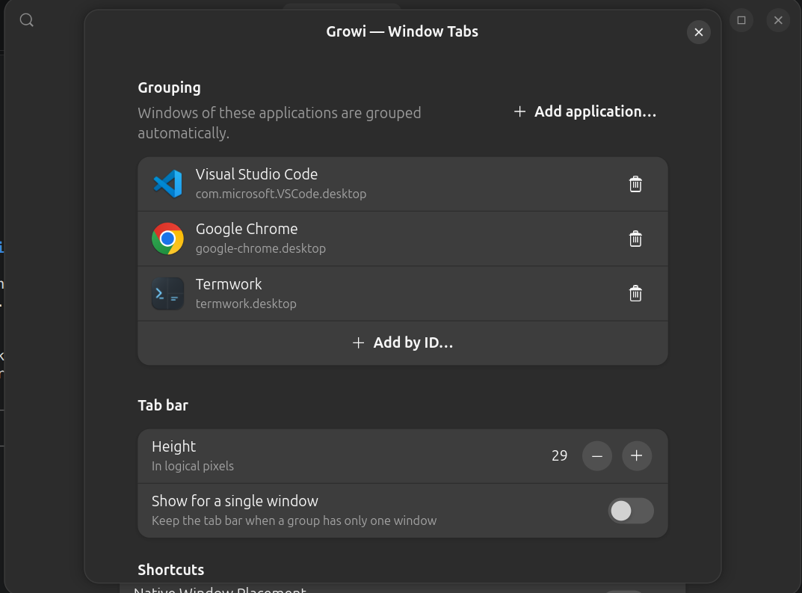

# Growi — Window Tabs

A GNOME Shell extension that stacks the windows of one application into a
tabbed group, with a tab bar above the window, so that for example all your
VS Code windows share one place on the screen and you switch between them like
browser tabs.

- Windows of the apps listed in the rules are grouped automatically, one group
  per app and per workspace. Any other window can be grouped on demand with a
  shortcut.
- All windows of a group have the same size and position; the active tab is
  raised on top, the others wait right behind it. Switching tabs only raises a
  window, so it is instant.
- Minimizing the active tab minimizes the whole group. Moving the active window
  to another workspace takes the whole group along.

Requires GNOME Shell 50 on Wayland.

## Install

Requires `make`, `glib-compile-schemas`, and `gnome-extensions` (included with
GNOME Shell).

```sh
git clone https://github.com/9ticks/growi.git
cd growi
make install                      # builds and installs growi@9ticks.github.io.shell-extension.zip
```

GNOME Shell on Wayland only discovers new extensions at login: **log out and
log back in**, then enable it:

```sh
gnome-extensions enable growi@9ticks.github.io
```

After later updates, `make install` again and log out and back in.

To remove it: `gnome-extensions uninstall growi@9ticks.github.io`.

## Usage

### Tab bar

| Action                     | Effect                                         |
| -------------------------- | ---------------------------------------------- |
| Left-click a tab           | Switch to that window                          |
| Middle-click a tab, or ×   | Close that window                              |
| Right-click a tab          | Detach the window from the group (moved aside) |
| Mouse wheel over the bar   | Previous / next tab                            |

The bar is shown for groups of two or more windows (or always, see
`Show for a single window` in the preferences). It is hidden in the overview,
for fullscreen windows and while the group is minimized. When there is no room
above a window (maximized, tiled, or at the top of the screen), the bar's
height is taken from the window instead.

Focusing a hidden tab by any other route (Alt+Tab, the dash, a notification)
also switches to it.

### Shortcuts

| Shortcut              | Effect                                                                  |
| --------------------- | ----------------------------------------------------------------------- |
| `Super+Alt+Page_Down` | Next tab of the focused group                                            |
| `Super+Alt+Page_Up`   | Previous tab of the focused group                                        |
| `Super+Alt+G`         | Detach the focused window from its group (moved aside), or attach it to the group of its app on this workspace, also for apps that are not in the rules |

A window attached with `Super+Alt+G` stays grouped until it is closed or
detached. A detached window is not grouped again automatically until it is
closed.

### Preferences



```sh
gnome-extensions prefs growi@9ticks.github.io
```

or the Extensions app. Every setting applies immediately:

- **Grouping**: one row per app rule, with the app's icon and name when the
  rule matches an installed app (by desktop ID or `StartupWMClass`), otherwise
  the rule itself, marked "App not installed" for a `.desktop` ID and "WM
  class" for anything else. The trash button removes that rule. **Add application…** opens a searchable list of installed apps (by
  name, ID or keyword); apps already covered by a rule are checked and can't be
  picked again, and picking one adds its desktop ID. **Add by ID…** adds a WM
  class or app ID by hand, e.g. for an app that is not in the list (see
  [Finding an app ID](#finding-an-app-id)); empty input and rules that already
  exist are refused. Windows of a newly added app are grouped at once; windows
  of a removed app are released and fanned out down-right of the group's place
  (the front tab stays where it is), like a detached window. Windows attached
  or detached by hand keep their state. The list also follows changes made
  with `gsettings`.
- **Tab bar height** (20–64 logical pixels) and **Show for a single window**.
- **Shortcuts**, as GTK accelerators (`<Super><Alt>Page_Down`), several
  separated by commas, empty to disable. Invalid accelerators are shown in red
  and not saved.

### Finding an app ID

A rule is a desktop app ID or a WM class, matched case-insensitively, with or
without `.desktop`:

- Desktop app IDs are the `.desktop` file names in `/usr/share/applications`,
  `~/.local/share/applications` or `/var/lib/flatpak/exports/share/applications`,
  e.g. `com.microsoft.VSCode.desktop`, `google-chrome.desktop`.
- For apps without one, use the WM class: press `Alt+F2`, run `lg` (Looking
  Glass), open the **Windows** tab and read `wmclass` / `app`.

The app picker lists the apps whose `.desktop` files are found in
`XDG_DATA_DIRS` of the preferences process, which includes Flatpak and Snap
exports on a standard Ubuntu session.

The defaults cover VS Code, VS Code OSS and VSCodium, both as native Wayland
(`com.microsoft.VSCode.desktop`, `code.desktop`) and XWayland (`Code`) windows.

### VS Code tip

Tabs show the window title. VS Code puts the file name first by default, so
put the project name first instead, in your user `settings.json`:

```json
"window.title": "${rootName}${separator}${activeEditorShort}"
```

## Development

| Command        | What it does                                                          |
| -------------- | --------------------------------------------------------------------- |
| `make schemas` | Compile the GSettings schema                                          |
| `make lint`    | ESLint over the extension, its preferences, tests and the smoke tools  |
| `make test`    | Unit tests of the pure helpers (`gjs -m tests/run.js`)               |
| `make pack`    | Build `growi@9ticks.github.io.shell-extension.zip`                               |
| `make smoke`   | Headless end-to-end test (see below)                                  |
| `make install` | Install the zip into **your current session**                         |

`make smoke` runs a nested `gnome-shell --headless` on a private D-Bus session
with temporary `HOME`/XDG directories and a keyfile GSettings backend, opens
GNOME Text Editor and Calculator windows in it, drives the extension through
`org.gnome.Shell.Eval` (unlocked by the test-only `tools/smoke-helper@local`)
opens the preferences window, and builds the preferences page in a plain gjs
process (`tools/prefs-check.js`) to drive the rule list, the app picker (with a
fake app list) and "Add by ID…". It never touches your session, your dconf
database or your installed extensions. `SMOKE_KEEP=1 make smoke` keeps its
temporary directory (with the shell log) for debugging.

### Debugging

Shell-side messages and errors from the extension go to the journal:

```sh
journalctl -f -o cat /usr/bin/gnome-shell
```

Preferences run in a separate process (`org.gnome.Shell.Extensions`); its errors
are shown in the preferences window and in `journalctl -f -o cat`.

## Known limitations

- Wayland only; tested on GNOME Shell 50. X11 sessions are not supported.
- Tabs cannot be reordered by dragging.
- Hidden tabs are real windows stacked behind the active one, so they stay
  listed in Alt+Tab and the dash (choosing one switches to it).
- While you drag or resize the active window, the other tabs are made
  transparent and catch up when you release it.
- The bar can briefly lag behind window animations (map, unminimize, workspace
  switch).
- Shortcuts are edited as text; there is no shortcut recorder.

## License

Released under the [GNU General Public License v3.0 or later](LICENSE).
